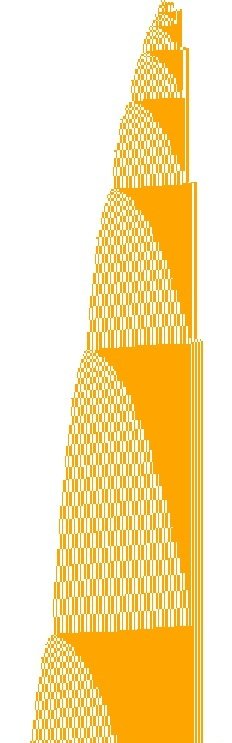

# 1RB0RB_1LC1RF_0RD0LB_0RA1LE_1LD---_0RB0RC halts (BB(6) holdout)

Author: Thomas Reus, with the AI model Claude Opus 5.5  
Status: 22 Oct 2026 (informal result, independently confirmed; not a formal proof)

The BB(6) holdout

    1RB0RB_1LC1RF_0RD0LB_0RA1LE_1LD---_0RB0RC

**halts**, at **Bell 298,793,335** of its Bell structure (described below), in state E reading a 1 (`E1 = ---`).
At that point the long block of the tape has about 1.24·10⁸ bits as a number, so the machine runs for roughly 10^(7.5·10⁷) steps; this is far below the known lower bound for BB(6), so it is not a new champion, but it decides a holdout.

This is the first success of the "vampire method" developed for the [vampire family](https://github.com/thomasreus-bb/bb6-vampire-family-1RB0LA_0RC0RB_1LD1LA_1LC1RE_1RF0RD_1LC---): find the Bell structure of a machine, derive a finite table for the Bell map, estimate the halting rate with a Markov model, and if the rate is not too small, simulate the Bell map exactly and fast until the HALT.

<em>Space-time diagram from the blank tape. Each Bell grows by a factor of about 4/3.</em>

---

## In brief

| | |
|---|---|
| machine | `1RB0RB_1LC1RF_0RD0LB_0RA1LE_1LD---_0RB0RC` (in the list of 663 BB(6) holdouts; not in the DeepMind candidate list) |
| Bell configuration | `0 11 0 1 0 1^n W (0 1 0 11)^m`, head on the leftmost 0 in state D |
| Bell map | n' = (4n + c)/3, (W', Δm, c) = f(W, min(m,3), n mod 3); table with **192 words** |
| start | Bell 1: n = 4, W = empty, m = 1 |
| Markov estimate | halting rate ≈ **1.6·10⁻⁹ per Bell**, expected ≈ 6.4·10⁸ Bells |
| result | **HALT at Bell 298,793,335** (W = `00`, n ≡ 2 mod 3), found by `sim/belldc3` in about 2 minutes |

---

## The method

### 1. Finding the Bell structure
A scan of the 663 holdouts ([vampire repository](https://github.com/thomasreus-bb/bb6-vampire-family-1RB0LA_0RC0RB_1LD1LA_1LC1RE_1RF0RD_1LC---), `scan/`) marked this machine as Bell-like with growth factor 4/3 (class B).
A detector for "Bell starts" (tape = one long block plus short words, the long block growing geometrically from level to level) then showed for this machine many *different* short words at a regular growth of 4/3, which is the signature of a vampire-like machine. Most other candidates showed only one or two words ("needles": all information is in one number, halting needs an exact value) or several long blocks.

At the start of each Bell the tape is

    0 11 0 1 0  1^n  W  (0 1 0 11)^m            head on the leftmost 0, state D

with a long block `1^n`, a short word W and a counter of m units `01011` on the right.

### 2. The Bell map
During one Bell the machine converts the block `1^n` from the left: every 3 ones become 4 ones, and the word W is rewritten at the end. The result is again a Bell configuration with

    n' = (4n + c)/3,     W' and Δm (m' = m + Δm) and c depending only on W, min(m,3) and n mod 3.

Only the lowest base-3 digit of n is read in a Bell, exactly as only the lowest bit of k is read in a Bell of the vampire family (there: k' = 3·⌊k/2⌋ + c). So this machine is a vampire in base 3.

`src/derive_table.py` derives the table by breadth-first search over the words W: for each word and each class of m (0, 1, 2, ≥ 3) and each residue n mod 3 it builds the tape, runs the **real Turing machine** (`src/bellrun.py`) for one Bell and reads off W', Δm and c. The search closes with **192 words** and 1,662 table entries (`table/bell_table.txt`); 5 entries are HALT (word `00` or `00010`, n ≡ 2 mod 3, for m ≥ 1). The HALT entries do not depend on the counter m.

### 3. Markov estimate
Treating n mod 3 as independent and uniform, the words W form a Markov chain (`src/markov.py`):

- halting rate ≈ **1.565·10⁻⁹ per Bell**, i.e. expected about 6.4·10⁸ Bells;
- the counter m grows by about 0.10 per Bell (it does not matter for halting);
- most frequent words: empty 59.0 %, `011` 23.5 %, `010` 7.9 %.

The observed frequencies of the words along the true orbit (first 200,000 Bells) agree with the Markov chain to three digits (empty 58.96 %, `011` 23.39 %, `010` 7.87 %), and the residues n mod 3 are equally frequent (33.3 % each).

For comparison: the vampire family has a halting rate of about 8.9·10⁻¹³ per Bell, about 1800 times smaller.

### 4. Fast exact simulation: `sim/belldc3.c`
The Bell map is iterated exactly with GMP, using divide and conquer in base 3:

- write n = q·3^B + r with r < 3^B; the next B Bells depend only on r, and afterwards n = q·4^B + r_B;
- r_B is computed recursively in the same way (B Bells = B/2 Bells on the low part, one combination, B/2 Bells on the result); only blocks of at most 20 Bells are simulated directly on a 64-bit word, with the table;
- multiplying by 4^B is a shift, so the main cost is the division by 3^B.

n grows by only log₂(4/3) ≈ 0.415 bits per Bell, so even 10⁹ Bells need only numbers of about 4·10⁸ bits (50 MB). Speed on one core: 10⁸ Bells in 36 s; the HALT at Bell 298,793,335 was reached in about 2 minutes.

The program writes checkpoints (`checkpoints3/bell_<N>_chkpt.txt`), a log line with KCHECK = n mod 2⁶⁴, the bit length of n, W, m, and D = the smallest distance to a HALT entry reached so far (d(W) = number of Bells from W to a HALT entry if the digits of n are suitable; between 1 and 20 here).

---

## Result

`sim/progress3_reference.log` (excerpt):

    ckpt     bell 100000000  KCHECK 7287110323392295348 41503754 W=e m=10246106  d 19 D 2 (Bell 95496251)
    ckpt     bell 200000000  KCHECK 15918270568610413956 83007504 W=e m=20495067  d 19 D 1 (Bell 154541599)
    HALT at Bell 298793335: W = 00, m = 30617182
    target   bell 298793327  KCHECK 17971086424594996336 124010439 W=01011011 m=30617181  d 9

On the way, the orbit came within d = 1 of a HALT entry at Bell 154,541,599 without halting. At Bell 298,793,335 the word `00` met n ≡ 2 mod 3.

## Checks

1. **Table against the TM.** Every one of the 1,662 table entries was re-derived by direct simulation of the Turing machine for three different sizes of n (n = 3a + r with a = 41, 97, 160) and, for the class m ≥ 3, for m = 3, 5 and 11: 8,442 tests, **no mismatch** (`verify/verify_table.py`, output `verify/verify_table.out`).
2. **Start of the orbit.** Iterating the table from Bell 1 (n = 4, W empty, m = 1) reproduces the direct simulation of the machine from the blank tape for the first 30 Bells, up to n = 69,203 (3·10⁹ TM steps).
3. **The simulator.** `belldc3` agrees with a naive big-integer iteration of the table (`src/run_table.py`) at Bells 1,001, 100,001 and 1,000,001 (KCHECK, bit length, W, m); runs with different block sizes give the same states (e.g. a run with target 298,793,327 reaches that Bell without halting, with the same state).
4. **The last 8 Bells on the real machine.** The next 8 Bells depend only on n mod 3⁹. At Bell 298,793,327 the state is W = `01011011`, m ≥ 3, n mod 3⁹ = 17,594. A direct simulation of the Turing machine from the tape `0 11 0 1 0 1^17594 01011011 (01011)^6` (`verify/final_bells.c`) **halts after exactly 8 Bells**, in state E reading a 1, as predicted (`verify/final_bells.out`, 3.1·10¹⁰ TM steps).
5. **Plausibility.** The HALT came at 3·10⁸ Bells, within the range expected from the Markov estimate (6.4·10⁸).

6. **Independent confirmation (22 Oct 2026).** Dennis (bbchallenge Discord) re-did the whole computation independently, starting from the TM alone and comparing with the data files only at the end: his own derivation of the Bell table (identical on every shared key), his own divide-and-conquer iteration (Python + gmpy2; agrees with a naive loop up to 10⁶ Bells, two block splits give identical results, all checkpoints and KCHECK lines match), and direct TM runs from reduced configurations for the last Bells. He obtains the same HALT: Bell 298,793,335, W = `00`, n ≡ 2 mod 3, m = 30,617,182, **n with 124,010,443 bits and n mod 2⁶⁴ = 10538133604703710903**; these values also follow from `belldc3`'s checkpoint at Bell 298,793,327 with 8 more Bells of the table.

**What is not proven formally:** that the Bell map with this table describes the machine for all n (the table entries were checked for several n and m, and the Bell only reads the lowest base-3 digit, but there is no formal proof), and the correctness of the long computation (GMP, one program). A second, independent implementation of the Bell iteration has meanwhile confirmed the result (check 6); what remains open is a formal proof, e.g. in Rocq (Coq): the Bell lemmas look easy, the hard part is certifying the ~3·10⁸-Bell iteration with numbers of ~1.24·10⁸ bits.

---

## Reproducing

    sudo apt install -y libgmp-dev
    cd sim
    gcc -O3 -march=native -o belldc3 belldc3.c -lgmp
    ./belldc3 -i 100000000            # from the newest checkpoint in checkpoints3/ (Bell 1,000,001 is included) until HALT

    cd ../verify
    gcc -O2 -o final_bells final_bells.c
    ./final_bells 17594 01011011 6    # the last 8 Bells on the real TM (about 3 minutes)

    cd ../src
    python3 markov.py                 # Markov estimate
    python3 run_table.py 100000       # naive iteration of the table (for comparison with belldc3)
    python3 derive_table.py           # derive the table again from the TM (several minutes)
    python3 ../verify/verify_table.py # check all table entries (about 20 minutes)

To get the state 8 Bells before the HALT: `./belldc3 -t 298793327`, then n mod 3⁹ from `n_hex` in the checkpoint.

## Files

| file | content |
|---|---|
| `table/bell_table.txt` | the Bell table: W, min(m,3), n mod 3 → W', Δm, c (192 words, 1,662 entries, 5 HALT) |
| `sim/belldc3.c`, `sim/tab3.txt` | fast exact simulation (divide and conquer, GMP, base 3) and its table in numeric form |
| `sim/checkpoints3/` | checkpoints at Bells 1,001, 100,001, 1,000,001 |
| `sim/progress3_reference.log` | log of the run that found the HALT |
| `src/bellrun.py` | runs the Turing machine for one Bell from a given Bell configuration |
| `src/derive_table.py` | derives the table by breadth-first search over the words |
| `src/iter_table.py`, `src/run_table.py` | naive exact iteration of the table |
| `src/markov.py` | Markov estimate of the halting rate |
| `verify/verify_table.py`, `verify/verify_table.out` | check of all table entries against the TM |
| `verify/final_bells.c`, `verify/final_bells.out` | direct TM simulation of the last 8 Bells |

## Related
- Vampire family (same method, base 2, orbits simulated to 10¹⁰–10¹¹ Bells without halt): [bb6-vampire-family-…](https://github.com/thomasreus-bb/bb6-vampire-family-1RB0LA_0RC0RB_1LD1LA_1LC1RE_1RF0RD_1LC---)
- Discussion: bbchallenge Discord.
